# TP RDP : Configuration et utilisation de Remote Desktop Protocol

> **Cours :** Services Réseaux Avancés — L3 GLSI, DGI / ESP — Année académique 2026-2027  
> **Enseignant :** Dr GUEYE  
> **Binôme :** Abdoul Aziz Diop & Aïssata Mbaye  
> **Date de réalisation :** 25/11/2026

---

## Sommaire

1. [Objectifs du TP](#1-objectifs-du-tp)
2. [Rappel théorique sur RDP](#2-rappel-théorique-sur-rdp)
3. [Environnement de travail](#3-environnement-de-travail)
4. [Partie 1 — Activer le Bureau à distance sur le serveur Windows](#partie-1--activer-le-bureau-à-distance-sur-le-serveur-windows)
5. [Partie 2 — Connexion au serveur RDP depuis un client Windows](#partie-2--connexion-au-serveur-rdp-depuis-un-client-windows)
6. [Partie 3 — Connexion au serveur RDP depuis un client Linux](#partie-3--connexion-au-serveur-rdp-depuis-un-client-linux)
7. [Partie 4 — Activation du service RDP sous VirtualBox](#partie-4--activation-du-service-rdp-sous-virtualbox)
8. [Problèmes rencontrés et solutions](#problèmes-rencontrés-et-solutions)
9. [Observations de sécurité](#observations-de-sécurité)
10. [Conclusion](#conclusion)

---

## 1. Objectifs du TP

Ce TP a pour but de mettre en œuvre le protocole **RDP (Remote Desktop Protocol)** dans un
environnement hétérogène Windows / Linux. Concrètement, il s'agit de :

- configurer une machine **Windows 11** en serveur de Bureau à distance ;
- vérifier les prérequis système (édition de Windows, pare-feu, comptes utilisateurs) ;
- établir une connexion RDP depuis un **client Windows** avec l'outil natif `mstsc` ;
- établir une connexion RDP depuis un **client Linux (Ubuntu)** avec **Remmina** ;
- observer le comportement du protocole (authentification, certificat, gestion des sessions) ;
- dégager les bonnes pratiques de sécurité liées à l'exposition d'un service RDP.

---

## 2. Rappel théorique sur RDP

**RDP** est un protocole propriétaire développé par Microsoft qui permet d'ouvrir une session
graphique sur une machine distante, comme si l'on était physiquement devant elle.

| Caractéristique | Valeur |
|---|---|
| Port par défaut | **TCP 3389** (et UDP 3389 pour le transport accéléré) |
| Couche OSI | Application (7) |
| Modèle | Client / serveur |
| Service Windows | *Services Bureau à distance* (`TermService`) |
| Chiffrement | TLS, avec certificat auto-signé généré par la machine par défaut |

**Principe de fonctionnement.** Le serveur n'envoie pas une vidéo du bureau mais des
*primitives d'affichage* (rectangles, bitmaps, ordres de dessin) que le client reconstruit
localement : c'est ce qui rend RDP peu gourmand en bande passante comparé à une simple
diffusion d'écran. En sens inverse, le client transmet les événements clavier et souris.

À côté de ce flux principal, RDP ouvre des **canaux virtuels** qui transportent le
presse-papiers partagé, les imprimantes, les lecteurs de disque redirigés, l'audio et les
périphériques USB.

**Point important côté serveur :** seules les éditions **Professionnel, Entreprise et
Éducation** de Windows peuvent jouer le rôle de serveur RDP. L'édition *Famille* ne contient
que la partie cliente. C'est la raison pour laquelle la toute première étape du TP consiste à
vérifier l'édition de Windows installée.

**NLA (Network Level Authentication).** Lorsqu'elle est activée, l'authentification de
l'utilisateur a lieu *avant* l'ouverture de la session graphique. Cela réduit la surface
d'attaque et protège contre les tentatives de déni de service, puisqu'aucune session n'est
allouée tant que les identifiants ne sont pas validés.

---

## 3. Environnement de travail

| Rôle | Système | Adresse IP | Outil utilisé |
|---|---|---|---|
| **Serveur RDP** | Windows 11 Professionnel 25H2 (nom machine : `HP`) | `172.20.10.3/28` | Services Bureau à distance |
| **Client Windows** | Windows 11 | même réseau | `mstsc` (Connexion Bureau à distance) |
| **Client Linux** | Ubuntu 24.04 LTS (*noble*) | même réseau | Remmina 1.4.43 + `remmina-plugin-rdp` |

- **Réseau :** les machines sont sur un même réseau local `172.20.10.0/28`
  (partage de connexion), passerelle `172.20.10.1`.
- **Compte de test :** utilisateur local `aicha`, créé spécifiquement pour le TP.

---

## Partie 1 — Activer le Bureau à distance sur le serveur Windows

### 1.1 Vérification de la version de Windows

Avant toute configuration, on vérifie que l'édition installée autorise bien le rôle de serveur
RDP. On passe par **Paramètres → Système → Informations système**, ou par la commande `winver`.

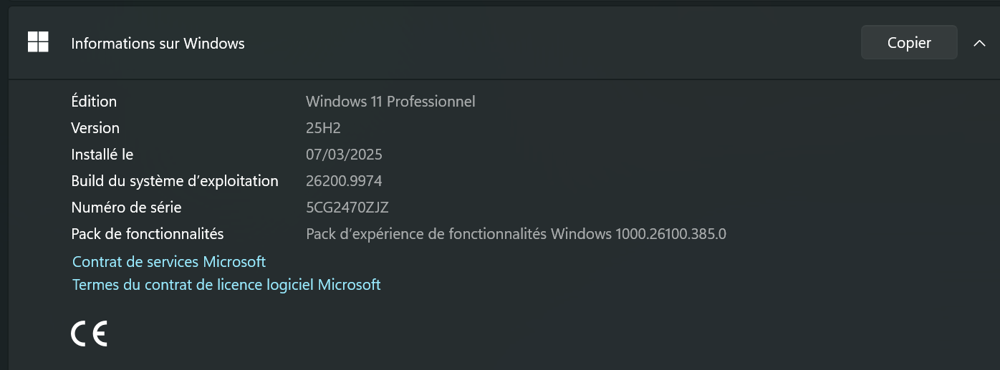

La machine est en **Windows 11 Professionnel**, version **25H2** (build 26200.9974) : le rôle
de serveur de Bureau à distance est donc disponible. Sur une édition *Famille*, l'option
n'apparaîtrait tout simplement pas dans les paramètres.

### 1.2 Activation du Bureau à distance

L'activation se fait dans **Paramètres → Système → Bureau à distance**, en basculant
l'interrupteur sur *Activé*.

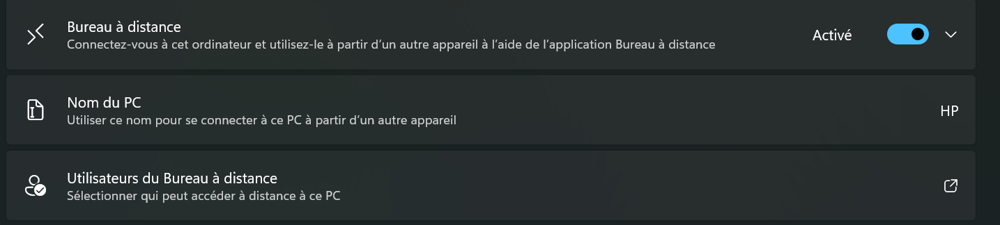

Trois informations sont à retenir sur cet écran :

- l'interrupteur **Bureau à distance** est sur *Activé* : le service `TermService` démarre et
  se met en écoute sur le port **3389** ;
- le **nom du PC** est `HP` : il peut servir d'identifiant de connexion à la place de
  l'adresse IP si la résolution de noms fonctionne sur le réseau local ;
- l'entrée **Utilisateurs du Bureau à distance** permet de désigner qui a le droit de se
  connecter (voir § 1.4).

> L'équivalent en ligne de commande, utile pour scripter l'opération :
> ```powershell
> Set-ItemProperty -Path 'HKLM:\System\CurrentControlSet\Control\Terminal Server' `
>   -Name 'fDenyTSConnections' -Value 0
> ```

### 1.3 Relevé de l'adresse IP du serveur

Le client doit connaître l'adresse du serveur. On l'obtient avec `ipconfig` :

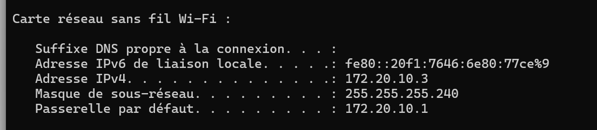

```
Adresse IPv4 . . . . . . . . . . : 172.20.10.3
Masque de sous-réseau . . . . . . : 255.255.255.240
Passerelle par défaut . . . . . . : 172.20.10.1
```

Le masque `255.255.255.240` correspond à un préfixe **/28**, soit un réseau de 16 adresses
dont 14 utilisables. Client et serveur appartiennent bien au même sous-réseau, aucune route
ni redirection de port n'est donc nécessaire.

### 1.4 Configuration de l'accès des utilisateurs

Un compte local dédié au TP est créé depuis une invite de commandes **en tant
qu'administrateur** :

```cmd
net user aicha passer /add
```

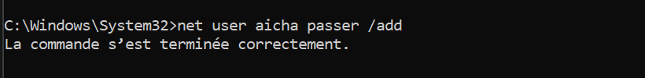

Le compte est ensuite autorisé à ouvrir une session distante via
**Bureau à distance → Utilisateurs du Bureau à distance → Ajouter**.

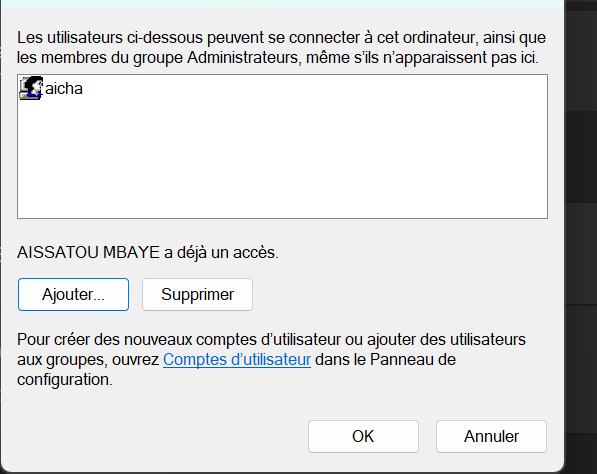

L'utilisateur `aicha` apparaît désormais dans la liste. On remarque le message
« *AISSATOU MBAYE a déjà un accès* » : les membres du groupe **Administrateurs** disposent
implicitement du droit de connexion à distance et n'ont donc pas besoin d'être ajoutés ici.

> Un compte RDP **doit posséder un mot de passe**. Windows refuse par défaut les connexions
> distantes avec un compte dont le mot de passe est vide.

### 1.5 Vérification des paramètres du pare-feu

Le pare-feu Windows Defender doit laisser passer le trafic entrant sur le port 3389. Les
règles correspondantes sont normalement activées automatiquement lors de l'activation du
Bureau à distance ; on le vérifie dans
**Pare-feu Windows Defender → Autoriser une application ou une fonctionnalité**.

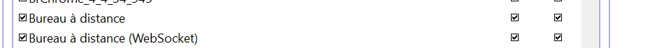

Les règles **Bureau à distance** et **Bureau à distance (WebSocket)** sont cochées pour les
profils *Privé* et *Public*. Si la connexion échouait, c'est le premier point à contrôler.
On peut aussi vérifier l'écoute effective du port côté serveur :

```cmd
netstat -an | findstr 3389
```

---

## Partie 2 — Connexion au serveur RDP depuis un client Windows

### 2.1 Ouverture de l'outil Connexion Bureau à distance

Sur le poste client Windows, on lance `mstsc` (touche *Windows* + R, puis `mstsc`) et on
saisit l'adresse du serveur.

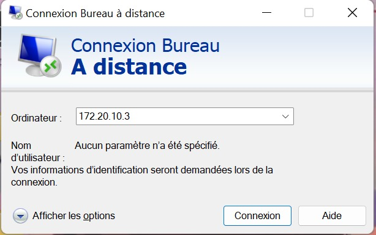

L'adresse **172.20.10.3** est renseignée dans le champ *Ordinateur*. Le champ *Nom
d'utilisateur* reste vide : les identifiants seront demandés au moment de la connexion, via
NLA, donc **avant** l'ouverture effective de la session graphique.

### 2.2 Gestion des options de connexion

Le bouton **Afficher les options** donne accès aux onglets de configuration de la session :

| Onglet | Réglages utiles |
|---|---|
| **Général** | identifiants, enregistrement du profil en fichier `.rdp` |
| **Affichage** | résolution de la session, profondeur de couleurs |
| **Ressources locales** | redirection du presse-papiers, des imprimantes, des disques locaux, de l'audio |
| **Expérience** | niveau de qualité graphique selon la bande passante, reconnexion automatique |
| **Avancé** | comportement en cas d'échec d'authentification du serveur, passerelle Bureau à distance |

Sur un réseau local, on peut laisser la qualité au maximum ; sur une liaison lente, réduire la
profondeur de couleurs et désactiver le papier peint améliore nettement la fluidité.

### 2.3 Prise de contrôle à distance

Après validation des identifiants, le bureau de la machine distante s'affiche et devient
pilotable au clavier et à la souris.

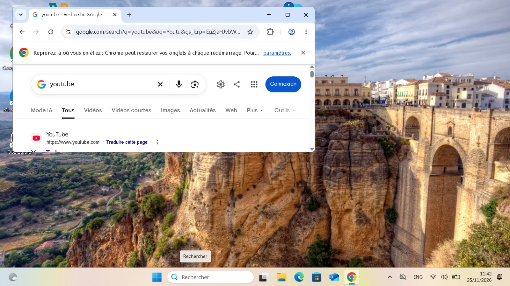

La session est pleinement fonctionnelle : navigation web, lancement d'applications, accès aux
fichiers. La barre de connexion en haut de l'écran permet de basculer en plein écran ou de
mettre fin à la session.

**Comportement à noter — une seule session interactive.** Les éditions « poste de travail » de
Windows (Pro, Entreprise) n'autorisent **qu'une seule session interactive à la fois**. Si un
utilisateur est déjà connecté localement sur la machine, l'ouverture d'une session RDP
provoque la déconnexion de cette session locale, après une boîte de dialogue d'avertissement.
C'est une limitation de licence, pas une limitation technique : seules les éditions **Windows
Server** avec le rôle *Services Bureau à distance* permettent plusieurs sessions simultanées.

Deux manières de quitter la session, à ne pas confondre :

- **Fermer la fenêtre / Déconnexion** : la session reste ouverte côté serveur, les
  applications continuent de tourner et on la retrouve à la reconnexion ;
- **Démarrer → Se déconnecter** : la session est réellement fermée et les applications
  sont arrêtées.

---

## Partie 3 — Connexion au serveur RDP depuis un client Linux

Le client RDP utilisé sous Ubuntu est **Remmina**, qui s'appuie sur la bibliothèque
**FreeRDP** (implémentation libre du protocole RDP).

### 3.1 Mise à jour des dépôts

```bash
sudo apt update
```

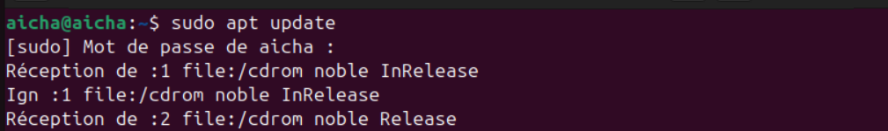

### 3.2 Installation du client RDP et de son greffon

Remmina est modulaire : le paquet principal ne gère aucun protocole par lui-même, chaque
protocole est fourni par un greffon. L'installation du greffon `remmina-plugin-rdp` est donc
**indispensable**, sans quoi RDP n'apparaîtrait pas dans la liste déroulante des protocoles.

```bash
sudo apt install remmina remmina-plugin-rdp
```

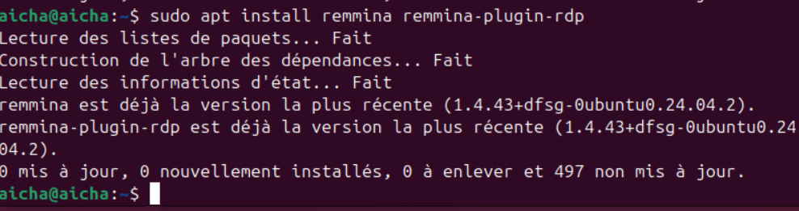

Ici APT indique que les deux paquets sont **déjà à la version la plus récente**
(1.4.43), Remmina étant installé par défaut sur Ubuntu Desktop.

> Alternative en ligne de commande pure, sans interface graphique :
> ```bash
> xfreerdp /v:172.20.10.3 /u:aicha /dynamic-resolution
> ```

### 3.3 Configuration du profil de connexion

Dans Remmina, on crée un nouveau profil de connexion :

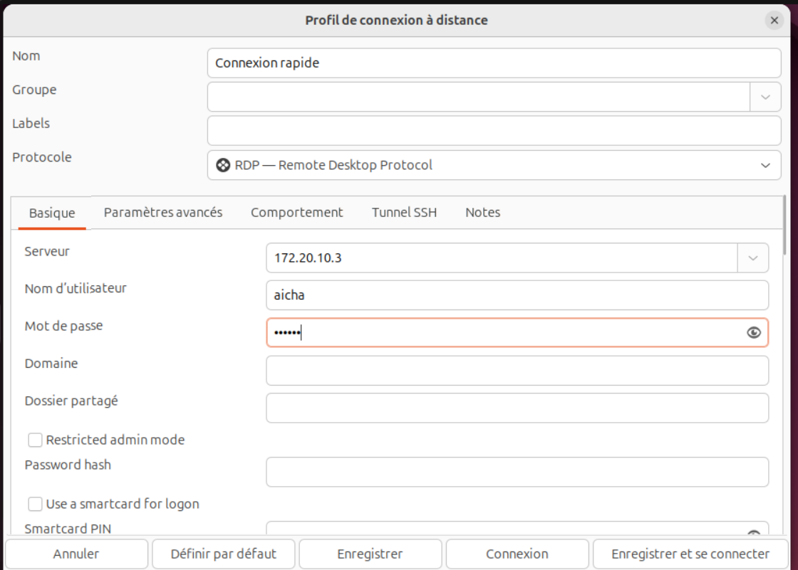

| Champ | Valeur |
|---|---|
| Nom | `Connexion rapide` |
| Protocole | **RDP — Remote Desktop Protocol** |
| Serveur | `172.20.10.3` |
| Nom d'utilisateur | `aicha` |
| Mot de passe | *(celui défini en § 1.4)* |
| Domaine | *(vide — compte local, pas de domaine Active Directory)* |

Le champ **Domaine** reste vide parce que le compte utilisé est un compte **local** de la
machine Windows. Il ne serait renseigné que dans un environnement Active Directory.

Les onglets *Paramètres avancés* et *Comportement* permettent d'ajuster la qualité
d'affichage, le partage du presse-papiers et les dossiers partagés ; l'onglet *Tunnel SSH*
autorise l'encapsulation de la session RDP dans un tunnel SSH, ce qui est une bonne pratique
dès que l'on sort du réseau local.

### 3.4 Avertissement de certificat

À la première connexion, Remmina affiche un avertissement relatif au certificat du serveur :

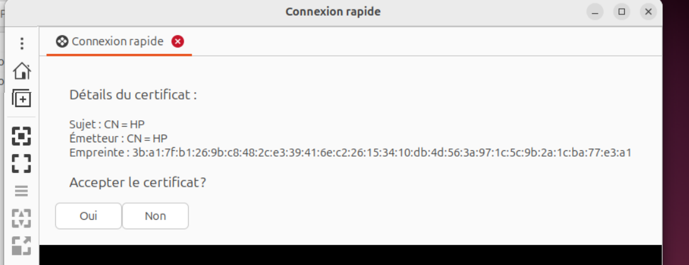

```
Sujet   : CN = HP
Émetteur: CN = HP
Empreinte : 3b:a1:7f:b1:26:9b:c8:48:2c:e3:39:41:6e:c2:26:15:...
```

Le **sujet et l'émetteur sont identiques** (`CN = HP`) : le certificat est **auto-signé**,
généré automatiquement par Windows lors de l'activation du Bureau à distance. Comme aucune
autorité de certification reconnue ne le signe, le client ne peut pas vérifier l'identité du
serveur et demande une validation manuelle.

En contexte de TP, on accepte le certificat en toute connaissance de cause (le serveur est sur
notre propre réseau local, et l'empreinte peut être comparée à celle affichée côté Windows).
En production, accepter aveuglément un certificat auto-signé ouvre la porte à une attaque de
type **« homme du milieu »** : il faut alors déployer un certificat signé par une autorité de
confiance.

### 3.5 Ouverture de la session

Le certificat accepté, l'authentification est transmise au serveur et la session s'ouvre :

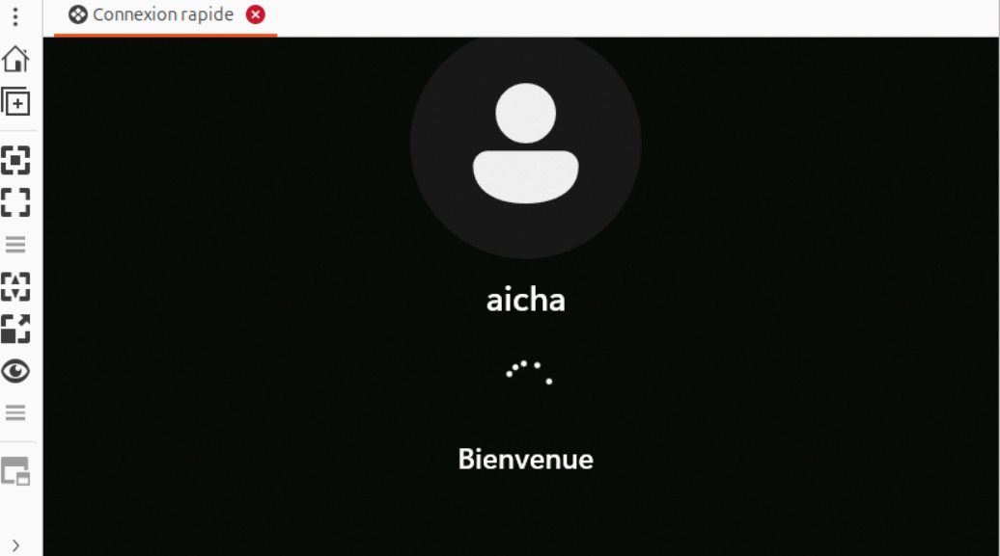

### 3.6 Bureau Windows affiché depuis Ubuntu

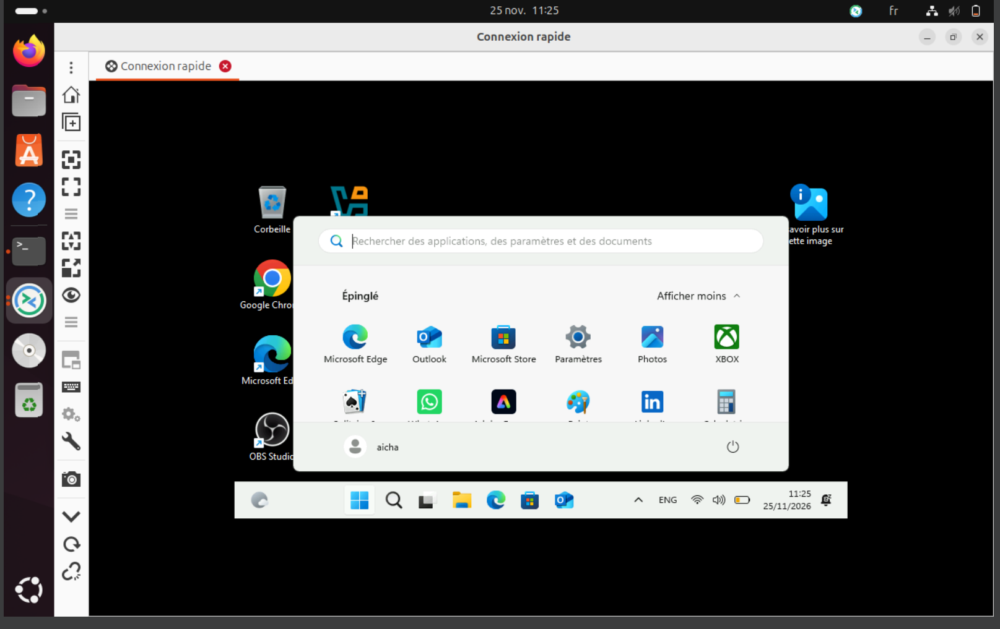

Le bureau Windows 11 complet s'affiche à l'intérieur de la fenêtre Remmina, sur un hôte
Ubuntu : menu Démarrer, barre des tâches et applications sont pleinement utilisables. La barre
d'outils verticale à gauche, propre à Remmina, donne accès au plein écran, à la mise à
l'échelle dynamique, au clavier virtuel et à la capture d'écran.

Cette étape démontre l'**interopérabilité** de RDP : le protocole étant normalisé et
implémenté librement par FreeRDP, un client non-Microsoft dialogue sans difficulté avec un
serveur Windows.

---

## Partie 4 — Activation du service RDP sous VirtualBox

> *Section en cours de réalisation — les captures correspondantes seront ajoutées dans
> `captures/04-virtualbox/`.*

L'objectif de cette partie est d'accéder en RDP à une machine virtuelle hébergée sous
**VirtualBox**. Deux approches sont possibles :

1. **RDP vers le système invité.** La machine virtuelle est configurée en mode réseau
   **Accès par pont (Bridged)** afin d'obtenir une adresse IP sur le réseau local, puis le
   service RDP est activé *à l'intérieur* de l'invité (Bureau à distance sous Windows,
   `xrdp` sous Linux).
2. **VRDP (VirtualBox Remote Display Protocol).** VirtualBox embarque son propre serveur,
   compatible RDP, qui donne accès à l'écran de la VM **indépendamment du système invité**
   — y compris pendant le démarrage. Il s'active dans
   *Configuration → Affichage → Serveur de bureau à distance*, et requiert le paquet
   d'extensions Oracle.

---

## Problèmes rencontrés et solutions

| Problème | Cause | Solution appliquée |
|---|---|---|
| Option « Bureau à distance » absente des paramètres | Édition Windows *Famille* | Vérifier l'édition en amont (§ 1.1) : seule l'édition *Professionnel* fait office de serveur |
| Connexion refusée / délai d'attente dépassé | Pare-feu bloquant le port 3389 | Activer les règles « Bureau à distance » dans le pare-feu (§ 1.5) |
| Identifiants rejetés depuis Remmina | Champ *Domaine* renseigné à tort | Laisser *Domaine* vide pour un compte local |
| Avertissement de certificat à chaque connexion | Certificat auto-signé non reconnu | Vérifier l'empreinte puis accepter le certificat |
| Session locale fermée à l'ouverture de la session distante | Une seule session interactive autorisée | Comportement normal sous Windows Pro (§ 2.3) |

---

## Observations de sécurité

RDP est l'un des services les plus ciblés sur Internet : un port 3389 ouvert est scanné et
attaqué en quelques minutes (attaques par force brute, *credential stuffing*, rançongiciels
diffusés par ce vecteur). Les bonnes pratiques suivantes s'imposent :

- **Ne jamais exposer directement le port 3389 sur Internet.** Passer par un **VPN** ou un
  **tunnel SSH** (`ssh -L 3389:127.0.0.1:3389 utilisateur@serveur`), ou par une passerelle
  Bureau à distance.
- **Imposer des mots de passe robustes** et une politique de verrouillage de compte après
  plusieurs échecs. Les mots de passe triviaux utilisés dans ce TP n'ont de sens que dans un
  environnement de laboratoire isolé.
- **Conserver NLA activé** afin que l'authentification précède l'allocation de la session.
- **Restreindre les adresses IP sources** autorisées dans la règle de pare-feu.
- **Changer le port d'écoute** (sécurité par l'obscurité : cela réduit le bruit des scans
  automatisés sans constituer une protection à part entière).
- **Limiter les comptes autorisés** au strict nécessaire dans le groupe
  *Utilisateurs du Bureau à distance*, et éviter d'y placer des comptes administrateurs.
- **Remplacer le certificat auto-signé** par un certificat signé par une autorité reconnue
  pour tout usage hors laboratoire.
- **Activer l'audit** des ouvertures de session et surveiller les journaux d'événements.
- **Désactiver les redirections inutiles** (disques, presse-papiers) pour limiter les fuites
  de données entre le poste client et le serveur.

---

## Conclusion

Ce TP a permis de configurer un poste **Windows 11 Professionnel** en serveur de Bureau à
distance et d'y accéder avec succès depuis deux clients de natures différentes : l'outil natif
`mstsc` sous Windows et **Remmina / FreeRDP** sous Ubuntu. L'interopérabilité du protocole est
donc vérifiée dans les deux cas.

Au-delà de la simple mise en œuvre, les manipulations ont mis en évidence les points
sensibles de RDP : la dépendance à l'édition de Windows côté serveur, le rôle déterminant du
pare-feu, la gestion des droits d'accès par utilisateur, la limitation à une session
interactive unique sur une édition « poste de travail », et surtout la question du certificat
auto-signé, qui rappelle qu'un service de prise en main à distance doit impérativement être
encadré par une politique de sécurité stricte.

---

## Arborescence du dépôt

```
.
├── README.md
└── captures/
    ├── 01-serveur-windows/
    ├── 02-client-windows/
    ├── 03-client-linux-remmina/
    └── 04-virtualbox/
```
